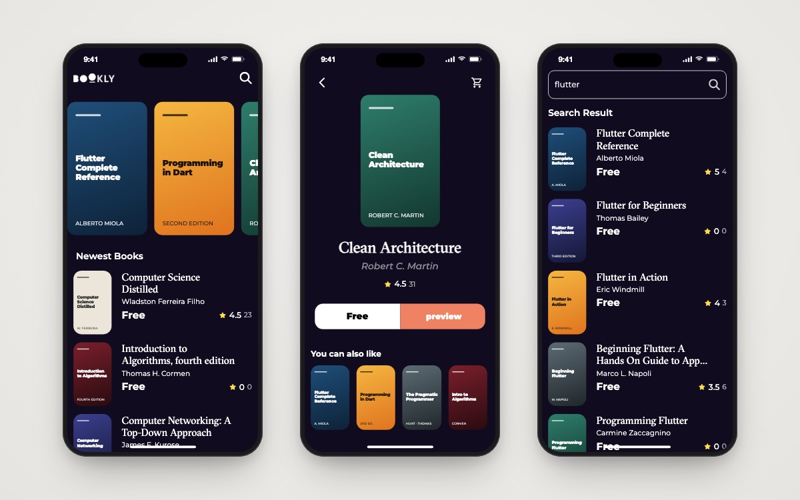

<h1 align="center">Bookly</h1>

<p align="center">Browse, search and preview free programming e-books from the Google Books API.</p>

<p align="center">
  
  
  
  
  
</p>

<p align="center">
  
  <br/><sub>Home · Book details · Search</sub>
</p>

## 📖 About

Bookly is a dark-themed book-discovery app built while learning **clean architecture** and **Bloc** in Flutter. It pulls featured, newest and similar books from the public **Google Books API** through Dio, maps failures into typed `Failure`s with `dartz`'s `Either`, and drives each section with its own Cubit. Book details open the book's Google Books preview in the browser.

## ✨ Features

- 🎞 **Animated splash**: the logo and the "Read free Books" tagline slide in (`SlideTransition`) before routing to Home.
- 📚 **Featured books carousel**: a horizontal list of programming books.
- 🆕 **Newest books**: a vertical "best seller"-style list with ratings and counts.
- 📖 **Book details**: cover, author, rating, and *Free* / *Preview* actions (`url_launcher` opens the preview link).
- 🔁 **"You can also like"**: a similar-books strip on the details page.
- 🔍 **Search**: query books by subject with loading and error states.
- 🖼 **Cached covers**: `cached_network_image` for smooth scrolling.

## 🛠 Tech stack

| Concern | Choice |
|---|---|
| State management | `flutter_bloc` (one Cubit per section: featured, newest, similar, search) |
| Architecture | Feature-first clean architecture: `data/` (models, repos) and `presentation/` (views, managers) |
| Networking | `dio` behind an `ApiService` wrapper |
| Error handling | `dartz` `Either<Failure, T>` + `ServerFailure.fromDioError` |
| Dependency injection | `get_it` |
| Routing | `go_router` |
| UI | `google_fonts` (Montserrat), custom GT Sectra font, `font_awesome_flutter`, `cached_network_image` |
| Other | `equatable`, `url_launcher` |

## 🏗 Project structure

```
lib/
├── core/
│   ├── errors/        # Failure / ServerFailure
│   ├── utils/         # ApiService, AppRouter, service locator, styles, assets
│   └── widgets/       # shared button, loading and error widgets
├── features/
│   ├── splash/        # animated splash
│   ├── home/          # data/ (BookModel, HomeRepo) + presentation/ (Cubits, views)
│   └── search/        # search repo, SearchBooksCubit, search views
└── main.dart
```

## 🚀 Getting started

```bash
git clone https://github.com/youssef336/Bookly_app.git
cd Bookly_app
flutter pub get
flutter run
```

No API key is needed: the app calls the public endpoint `https://www.googleapis.com/books/v1/volumes`.

## 👤 Author

**Youssef Belal Zakaria** · [GitHub @youssef336](https://github.com/youssef336)

⭐ If you like this project, give it a star!
